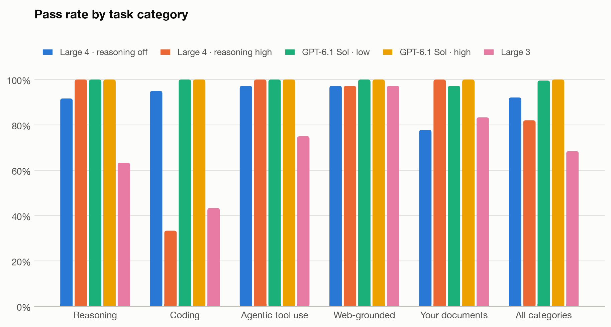
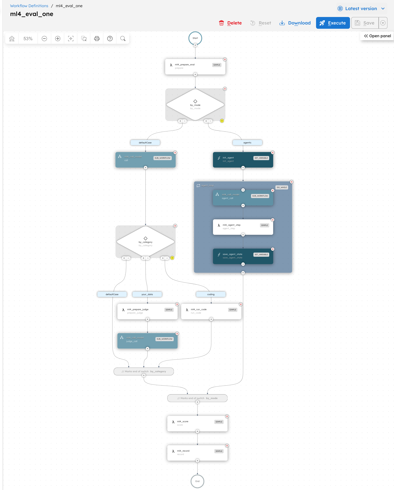
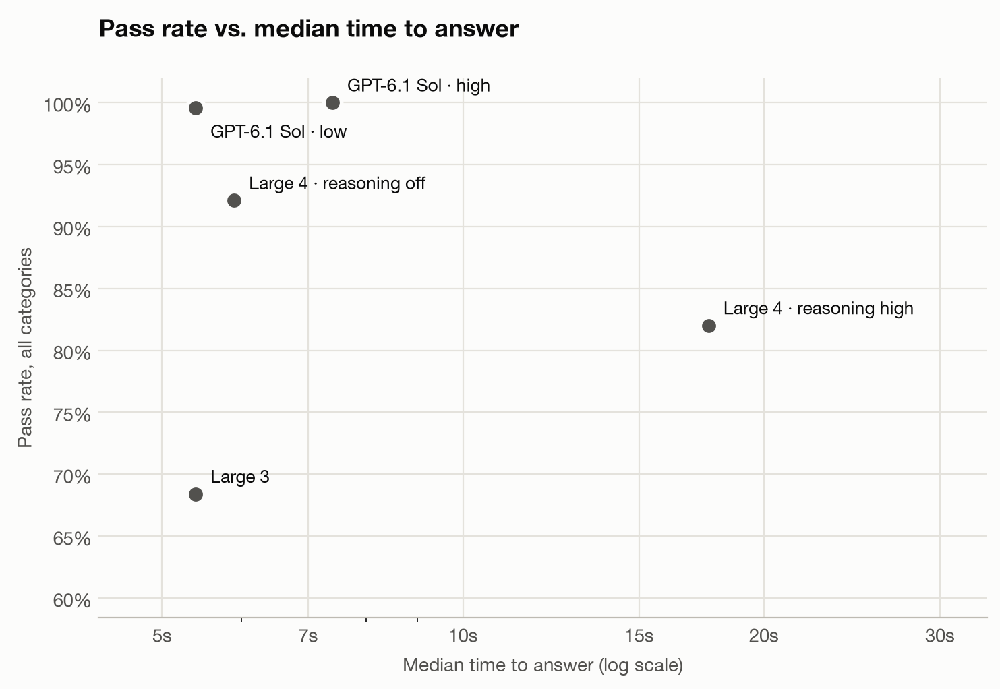
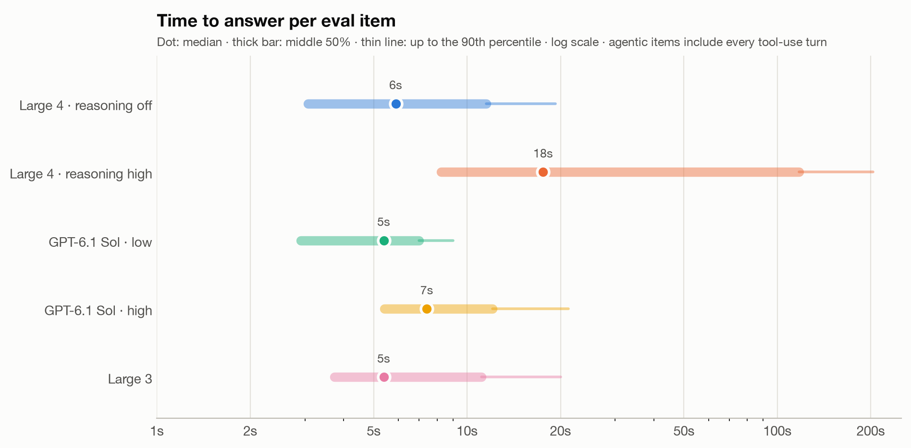
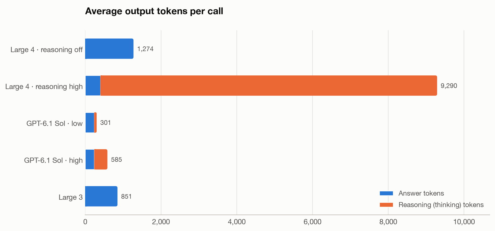
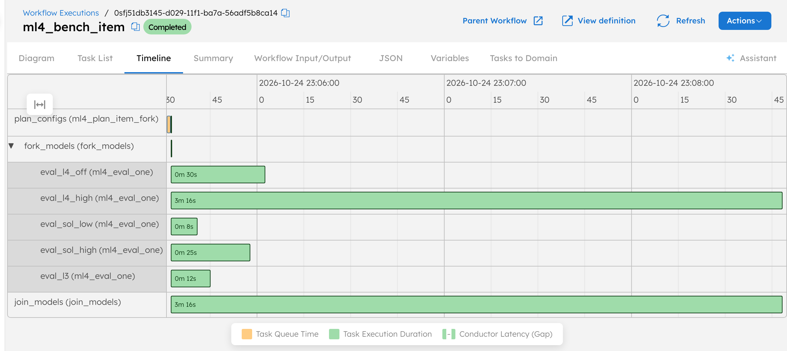
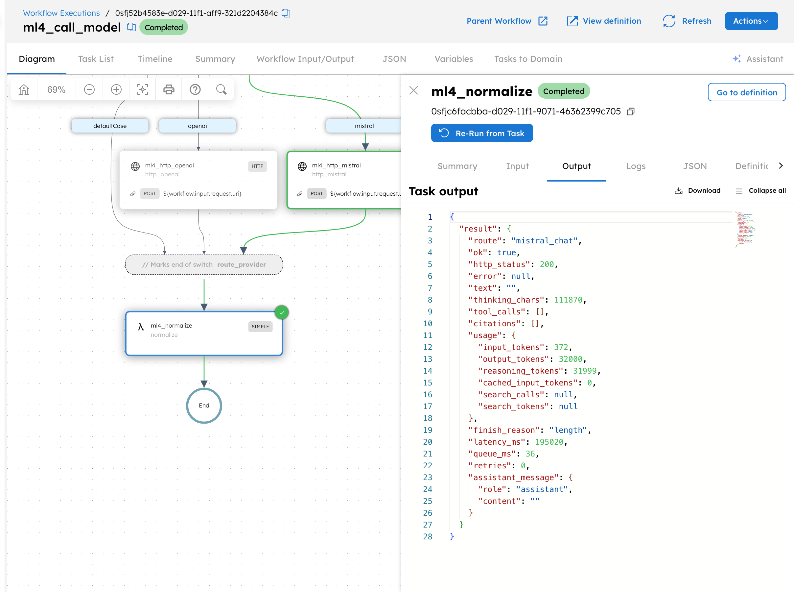
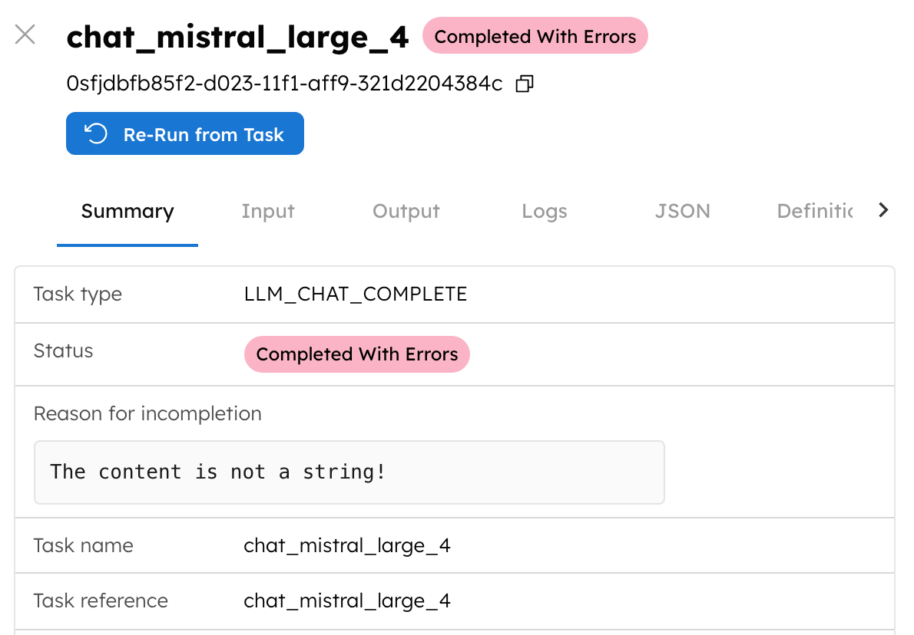
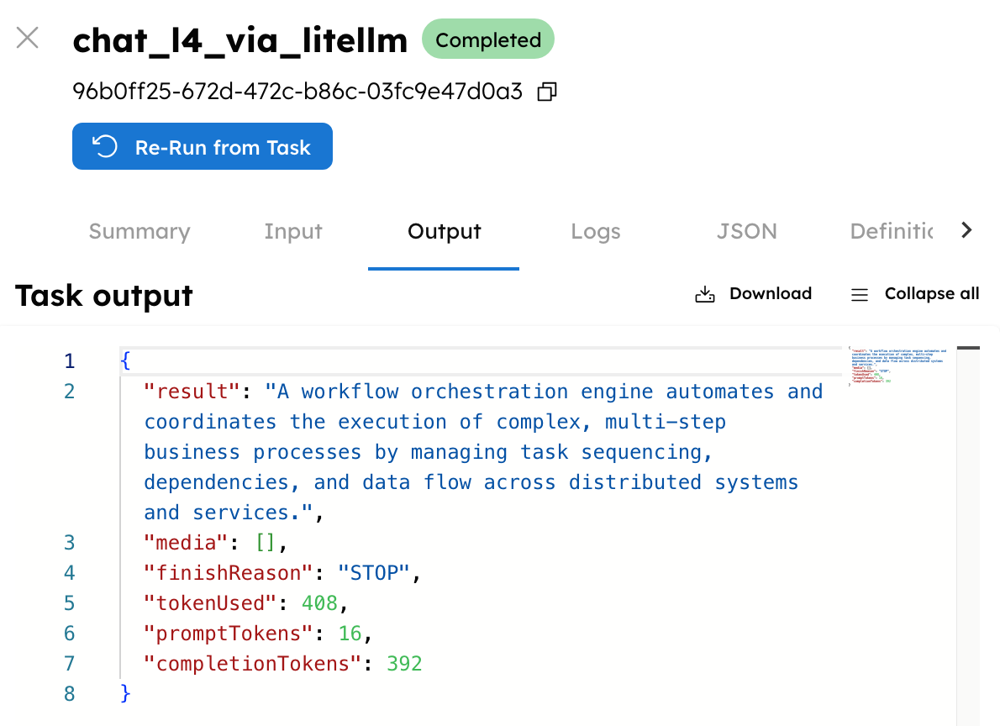

# Mistral Large 4 on Conductor: benchmark report

Runs: 2026-10-24/25 on Orkes Developer Edition (5.6.0-rc2), with a cross-check on Conductor OSS 3.32.5.
Mistral Large 4 is in public preview; numbers reflect the model as served on those dates.

## Summary

1,140 scored calls: 76 tasks × 5 model configs × 3 runs, on Orkes Developer Edition.

| Config | Pass rate (95% CI) | Median time to answer | Avg output tokens |
|---|---|---|---|
| Large 4 · reasoning off | **92%** (87–96%) | 5.9 s | 1,274 |
| Large 4 · reasoning high | **82%** (74–89%) | 17.6 s (p90 203 s) | 9,289 (8,889 thinking) |
| GPT-6.1 Sol · low | **100%** (99–100%) | 5.4 s | 301 |
| GPT-6.1 Sol · high | **100%** (100–100%) | 7.4 s | 585 |
| Large 3 | **68%** (58–77%) | 5.4 s | 851 |

- GPT-6.1 Sol passed 455 of 456 calls. On this eval set Sol sits at the ceiling, so the set shows where Large 4
  falls short of Sol but can't measure how much headroom Sol has.
- Large 4 with reasoning off was the best Large 4 setting: 92%, about as fast as Sol at low reasoning, and a large step
  up from Large 3 (better on 31 of 76 tasks, worse on 4).
- Large 4 with reasoning high was perfect on reasoning, agentic and document tasks, but passed only 33% of coding tasks.
  39 of its 60 coding calls spent the entire 32,000-token budget thinking (median 199 s) and returned no code. Raising the
  cap to 128k rescued 6 of 9 such tasks at a median of about 58k tokens per answer.
- On web-grounded questions Large 4 was as accurate as the others (97%) but ran about 5 times as many searches as Sol at low
  reasoning (6.5 vs 1.2 per question) and took 2.5 times as long (15 s vs 6 s).
- Large 4 with reasoning off made avoidable mistakes on questions about a private document (78%): contradicting its own
  conclusion, or adding claims the document doesn't support. With reasoning high it got all of them right.
- Conductor's built-in Mistral integration can't run Large 4 yet on any platform tested. HTTP tasks work everywhere, and on
  Conductor OSS the LiteLLM provider works.

## What we tested

**Question:** how does Mistral Large 4 do on realistic tasks, at what latency and token cost, compared with
the closest OpenAI model and with Mistral's previous flagship, and can you run it from Conductor today?

**Model configs**

| Config | Model | Setting | Why it's here |
|---|---|---|---|
| Large 4 · reasoning off | `mistral-large-4` | `reasoning_effort: none` | Large 4 as a fast instruct model |
| Large 4 · reasoning high | `mistral-large-4` | `reasoning_effort: high` | Large 4 with thinking (also its default) |
| GPT-6.1 Sol · low | `gpt-6.1-sol` | `reasoning_effort: low` | OpenAI's closest tier by price and positioning; `low` is its minimum |
| GPT-6.1 Sol · high | `gpt-6.1-sol` | `reasoning_effort: high` | Sol with full reasoning |
| Large 3 | `mistral-large-2512` | (no reasoning) | Mistral's previous flagship, as a baseline |

Large 4 accepts only `none` and `high` for `reasoning_effort` (the API rejects `low`, `medium`, `xhigh` and `max`),
and with no setting it reasons by default. GPT-6.1 Sol can't turn reasoning off; its lowest setting is `low`.
List prices on 2026-10-24: Large 4 $1.36 / $4.18, GPT-6.1 Sol $2 / $10, Large 3 $0.50 / $1.50 per 1M input / output tokens.

**Eval set:** 76 items, every expected answer verified by code or by at least two sources
(full list in `eval_inventory.md`):

| Category | Items | What a pass means | How it's scored |
|---|---|---|---|
| Reasoning | 20 | correct final answer to a fresh multi-step problem (counting, logic, dates/DST, code traces, probability) | exact match on the `ANSWER:` line |
| Coding | 20 | a Python function that passes every hidden unit test (12–20 asserts each) | run in a network-less Docker sandbox |
| Agentic tool use | 12 | the right tool calls with the right arguments, no forbidden action, a correct summary | trace check against a deterministic tool environment |
| Web-grounded | 12 | a correct answer about Aug–Oct 2026 events with at least one cited source | regex on the answer + citation present |
| Your documents | 12 | a faithful answer from a private handbook the models never saw (3 questions aren't answerable from it) | blind LLM judge (GPT-6 Astra) + key-facts check |

Each item ran 3 times per config (three independent runs), so every config has 228 scored calls.
All configs got identical prompts, a 32,000-token output cap (8,000 for web search) and each provider's
default sampling settings.

## How the harness runs on Conductor

- `ml4_bench_run` loads the eval set and works through it in batches of 8 items.
- `ml4_bench_item` sends one item to every model config in parallel with a dynamic fork, then joins.
- `ml4_eval_one` builds the request, calls the model (a `DO_WHILE` loop handles agentic tool calls), runs
  the hidden unit tests or the judge where needed, scores and records.
- `ml4_call_model` routes to Mistral or OpenAI over a plain HTTP task. API keys come from Conductor secrets,
  so the UI shows `Bearer ***`. Latency is the HTTP task's own start-to-end time on the Conductor server.

Model calls go over HTTP tasks because Conductor's built-in Mistral connector can't read Large 4's replies yet
(next section). Web-grounded questions use each provider's own search tool: Mistral's Conversations API with
`web_search`, OpenAI's Responses API with `web_search`. GPT-6.1 Sol's agentic runs also go through the
Responses API, because Sol rejects function tools together with reasoning on chat completions.

## Results

### Overall

| Config | Calls | Pass rate (95% CI) | Median latency | p90 latency | Avg output tokens | Avg thinking tokens | Hit 32k cap |
|---|---|---|---|---|---|---|---|
| Large 4 · reasoning off | 228 | 92% (87–96%) | 5.9 s | 19.3 s | 1,274 | 0 | 1 |
| Large 4 · reasoning high | 228 | 82% (74–89%) | 17.6 s | 203.3 s | 9,289 | 8,889 | 39 |
| GPT-6.1 Sol · low | 228 | 100% (99–100%) | 5.4 s | 9.0 s | 301 | 65 | 0 |
| GPT-6.1 Sol · high | 228 | 100% (100–100%) | 7.4 s | 21.2 s | 585 | 346 | 0 |
| Large 3 | 228 | 68% (58–77%) | 5.4 s | 20.0 s | 851 | 0 | 0 |

Confidence intervals are bootstrapped over tasks. Latency is per eval item; for agentic items it adds up every tool-use turn.

### By category

| Category | Large 4 · off | Large 4 · high | Sol · low | Sol · high | Large 3 |
|---|---|---|---|---|---|
| Reasoning (20) | 92% | 100% | 100% | 100% | 63% |
| Coding (20) | 95% | 33% | 100% | 100% | 43% |
| Agentic tool use (12) | 97% | 100% | 100% | 100% | 75% |
| Web-grounded (12) | 97% | 97% | 100% | 100% | 97% |
| Your documents (12) | 78% | 100% | 97% | 100% | 83% |

- **Reasoning.** Large 4 with reasoning off missed a string-transformation trace (2 of 3 runs), a counting problem (2 of 3,
  one of them its only 32k-cap hit) and a scheduling problem (1 of 3). With reasoning high it solved everything, at a median
  of 24.5 s against 4.8 s for Sol at low reasoning.
- **Coding.** Large 4 with reasoning off passed 95% of the hidden unit tests with a median of 3.6 s. With reasoning high the
  median coding call took 192 s, and 39 of 60 calls ended with `finish_reason: length` before any code was written (see
  "The thinking budget" below). One more call ended with `finish_reason: error` after 24,420 tokens and 154 s.
- **Agentic tool use.** Large 4 completed 35 of 36 scenarios with reasoning off and all 36 with reasoning high, averaging
  3.6 to 3.8 model turns like Sol. Its one failure booked a flight that broke the travel policy. Large 3 failed 9 runs,
  including 6 where it took an action the scenario forbids.
- **Web-grounded.** All configs answered correctly almost every time. Large 4's two misses were calls where Mistral's
  search endpoint returned search steps (and, once, a thinking chunk) but no answer text. Large 4 searched far more than the others (below).
- **Your documents.** The blind judge failed Large 4 (reasoning off) on 8 of 36 runs: in 3 it opened by calling a Friday
  15:00 deploy "allowed" before computing that it isn't, and in the rest it added claims the handbook doesn't support.
  The key-facts check passed all of those, which is why this category uses a judge.

| Web-grounded behavior | Searches per question | Search/input tokens per question | Median time |
|---|---|---|---|
| Large 4 · reasoning off | 6.5 | 30,003 (connector) | 15.2 s |
| Large 4 · reasoning high | 4.0 | 17,824 (connector) | 16.8 s |
| GPT-6.1 Sol · low | 1.2 | 13,380 (input) | 6.1 s |
| GPT-6.1 Sol · high | 2.3 | 19,998 (input) | 7.9 s |
| Large 3 | 1.3 | 8,735 (connector) | 4.5 s |

Mistral reports search content as `connector_tokens`; OpenAI counts it as input tokens.

### The thinking budget

Large 4 with reasoning high reached the 32,000-token output cap on 39 calls, all of them coding tasks, after a median of
199 s, and returned an empty answer each time (`finish_reason: length`, every token spent on thinking).

A follow-up gave Large 4 a 128,000-token cap on the 9 coding tasks where it had hit the cap in the first run:

| Task | Result at 128k | Output tokens | Time | Passed at 32k (3 runs) |
|---|---|---|---|---|
| coding-001 | passed | 82,958 | 749 s | 0/3 |
| coding-002 | passed | 57,724 | 670 s | 1/3 |
| coding-004 | passed | 46,938 | 289 s | 0/3 |
| coding-005 | passed | 24,548 | 175 s | 1/3 |
| coding-006 | passed | 23,474 | 749 s | 0/3 |
| coding-007 | hit 128k cap | 131,072 | 756 s | 0/3 |
| coding-008 | hit 128k cap | 131,072 | 641 s | 0/3 |
| coding-009 | `finish_reason: error` | 61,660 | 303 s | 1/3 |
| coding-011 | passed | 9,777 | 372 s | 1/3 |

The larger budget rescued 6 of 9 tasks, at a median of about 58k output tokens per answer. Times in this table are inflated:
the follow-up ran while the three main runs were also calling Mistral, and throughput dropped (one answer streamed at about
31 tokens/s against about 185 tokens/s earlier). For the same 9 tasks Large 4 with reasoning off passed 25 of 27 runs with a
median of 7.9 s.

### Consistency and head to head

| Config | Passed every run | Passed some runs | Never passed |
|---|---|---|---|
| Large 4 · reasoning off | 64 | 10 | 2 |
| Large 4 · reasoning high | 58 | 10 | 8 |
| GPT-6.1 Sol · low | 75 | 1 | 0 |
| GPT-6.1 Sol · high | 76 | 0 | 0 |
| Large 3 | 43 | 16 | 17 |

| Comparison (76 tasks) | First better | Tied | Second better |
|---|---|---|---|
| Large 4 · off vs Sol · low | 0 | 65 | 11 |
| Large 4 · high vs Sol · high | 0 | 58 | 18 |
| Large 4 · off vs Large 4 · high | 18 | 49 | 9 |
| Large 4 · off vs Large 3 | 31 | 41 | 4 |

### Scoring corrections made after the runs

Every change is logged in `results/full-r*/notes.md` and the originals are kept next to the results files.

1. **Citations (web-grounded).** The first scoring counted a citation only for a full `https://` link or a structured API
   reference. Large 4 often lists sources by title and website (`usopen.org`) or with Mistral's `search-result://` reference
   links, so 11 correct, sourced answers were marked uncited. The rule now accepts any URL, website or provider reference
   link (`scripts/rescore_grounding.py`).
2. **One document question (your_data-008).** The handbook says Friday changes must reach 100% *before* 16:00, so the latest
   start is 14:30 only under a loose reading. The original rubric accepted only 14:30 and failed GPT-6.1 Sol's stricter
   "before 14:30" in every run. The rubric now accepts either reading, and the stored answers were re-judged through the same
   Conductor judge workflow (`scripts/rejudge.py`, `evals/CHANGELOG.md`).
3. **One rate-limited call.** Large 3 hit Mistral's rate limit on one agentic run even after retries; it was re-run
   (`scripts/repair.py`).

### Spend (list prices)

| Item | Tokens | Cost at list price |
|---|---|---|
| Large 4 · reasoning off | 609,648 | $1.65 |
| Large 4 · reasoning high | 2,429,144 | $9.28 |
| GPT-6.1 Sol · low | 810,057 | $2.17 |
| GPT-6.1 Sol · high | 1,116,030 | $3.30 |
| Large 3 | 515,130 | $0.45 |
| GPT-6 Astra judge (180 verdicts) | 809,022 | $8.56 |
| 128k follow-up (9 calls) | 572,149 | $2.38 |

About $28 in model tokens, plus web-search tool fees and the pilot runs. Mistral's search content (`connector_tokens`)
isn't in these totals. Large 4 is in a discounted preview, so the actual Mistral charges may be lower.

## Running Large 4 inside Conductor today

Conductor's built-in Mistral integration (the `LLM_CHAT_COMPLETE` task with a Mistral provider) was tested on
three platforms on 2026-10-24 with the same workflow, `ml4_native_connector_check`:

| Platform | Large 3 (`mistral-large-2512`) | Large 4 (`mistral-large-4`) | OpenAI control |
|---|---|---|---|
| Orkes Developer Edition 5.6.0-rc2 | works | fails: `The content is not a string!` | works |
| Orkes standalone 6.0.0 (local image built Sep 21) | fails: response can't be parsed (gzip) | fails (gzip) | works |
| Conductor OSS 3.32.5 | fails: `Illegal character ((CTRL-CHAR, code 31))` (gzip) | fails (gzip) | works |
| Conductor OSS 3.32.5 via the LiteLLM provider | not tested | works, thinking on and off | works |

Two separate problems:

1. **Thinking replies (Large 4 only).** Large 4 reasons by default and returns its answer as a list of content
   chunks (a `thinking` chunk, then `text`). Conductor's Mistral provider is built on Spring AI 1.x, whose
   `ChatCompletionMessage.content()` throws `The content is not a string!` for anything but a plain string, and
   the provider has no way to send `reasoning_effort: none`. Tool-call replies carry a thinking chunk too, so
   agents hit the same error. Spring AI fixed this only in its 2.x line, which needs Spring Boot 4.
2. **Gzip (every Mistral model, open-source releases).** The provider sets `Accept-Encoding` by hand, which stops
   the HTTP client from decompressing Mistral's gzipped replies. Orkes shipped a fix in 5.5.7 on Oct 8; the
   open-source fix (conductor-oss#1198) is approved but not merged.

**What works today:** call Mistral from an HTTP task (this harness), or on Conductor OSS put a LiteLLM proxy in
front of Mistral and use the built-in `litellm` provider (`env/litellm/config.yaml` defines `mistral-large-4`
with thinking on and `mistral-large-4-fast` with it off).

The harness itself runs unchanged on Conductor OSS 3.32.5 (secrets come from `CONDUCTOR_SECRET_*` environment
variables). A 10-item sample there matched the Developer Edition pass/fail result on 18 of 20 overlapping calls,
with similar latencies.

## Operational notes

- Large 4 with `reasoning_effort: high` can spend the whole output budget thinking and return no answer
  (`finish_reason: length`), which in this benchmark cost about three minutes per call. Mistral accepts output
  caps up to 262,144 tokens; see the follow-up experiment for whether a larger cap helps.
- Large 4 thinks by default. If you don't set `reasoning_effort`, you pay for thinking tokens on every call.
- On Conductor OSS, HTTP tasks run on a shared system-task pool of CPU × 2 threads. A long Large 4 call holds a
  thread for its whole duration, so raise `conductor.app.systemTaskWorkerThreadCount` for LLM-heavy workloads.
- Developer Edition caps AI integrations at 5 models per account; HTTP-task calls don't count against it.
- Python workers: run with `CONDUCTOR_HTTP2_ENABLED=false` and short response timeouts. On HTTP/2 the server
  closes connections every ~2,000 streams and an in-flight task update can be lost; Developer Edition then
  re-queued the stuck task only after several minutes. Two such tasks were recovered during the runs (`results/*/notes.md`).

## Caveats

- GPT-6.1 Sol passed 455 of 456 calls, so this set can't rank Sol against harder alternatives or measure its headroom.
- One run date and three repeats per item; Large 4 is a preview model.
- Each provider's default sampling settings were used (Large 4 defaults to temperature 1.0).
- The judge (GPT-6 Astra) is from the same vendor as one contestant. It only grades the your-documents
  category, it never sees which model answered, and its verdicts are reported next to a programmatic
  key-facts check.
- Latency includes network time between Orkes Developer Edition (cloud) and each provider's API.
- The 32,000-token output cap is the same for every config; only Large 4 with reasoning high ever reached it.

## Reproduce

See the project `README.md`. Raw data: `results/full-r{1,2,3}/results.jsonl`; tables and charts are regenerated
with `scripts/analyze.py full-r1 full-r2 full-r3`.
